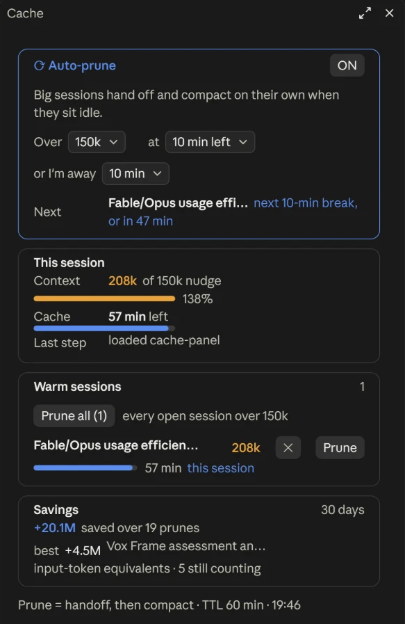

# cache-panel

**Keeps Claude Code sessions small, automatically.**

Every turn in Claude Code re-reads the whole conversation, so a session that has grown to 250k tokens costs about 250k tokens a turn, even when most of that is finished work. A prompt cache makes those re-reads cheap, but it expires an hour after the last reply. Once it's gone, the next message re-writes the whole context at full price.

cache-panel watches every session on your machine and prunes the big ones at the right moment. When you step away from the PC, or a session's cache is about to expire, it writes a detailed handoff file and then compacts the session. When you come back, the session resumes from the handoff instead of from a 250k-token transcript.



## What you get

- **A Cache button** in the prompt footer, which opens the panel (or use `/cache-panel`).
- **Warm sessions:** every session whose prompt cache is still alive, with minutes left, context size, and a **Prune** button. Sessions about to go cold are flagged.
- **Auto-prune** (off until you switch it on in the panel): big sessions (over 150k by default) hand off and compact on their own when:
  - you've been away from the keyboard for 10 minutes and the session hasn't replied for 10 minutes, so the break gets used for housekeeping (both clocks run together, so in practice it fires 10–20 minutes after the last reply), or
  - their cache is down to its last 10 minutes and about to expire.

  All three thresholds are dropdowns in the panel. Auto-prune only acts on a session while no turn is running in it.
- **Exclude:** the ✕ on a row keeps that session out of auto-prune, for a disposable giant task you'd rather not have compacted. **Include** puts it back. Manual Prune still works on excluded sessions.
- **This session:** context size against the next nudge, and the cache time left.
- **Savings:** an estimate of tokens saved by pruning over the last 30 days. It's measured in input-token equivalents, against never compacting at all, so read it as an upper bound.
- **A context nudge:** past 150k tokens, and every 75k after that, Claude is asked to judge whether much of the context is stale work. If it is, Claude offers to prune. If the old context is still in use, it says nothing.
- **Two skills:**
  - `/cache-panel:prune [task-name]` writes the handoff and gives you the `/compact` line to run.
  - `/cache-panel:cachecheck` prints cache warmth for every session.

### What "Prune" does

1. Claude writes `~/.claude/handoffs/<task>.md`. It holds the goal, the current state, decisions and why, exact values, and next steps, in enough detail that a fresh model can continue without re-reading files.
2. For each subagent: if its cache is still warm and it holds unfinished work, Claude asks it to write its own handoff. Cold subagents are never woken, because waking one re-sends its whole context at full price.
3. The session is compacted, with instructions to read the handoff first.

## Results

Over two months of the author's own heavy use (26 early compactions, by hand at first and then with this plugin, on sessions of 90k–930k tokens), compacting early saved an estimated **58.8 million input tokens**: 46% of what those stretches of conversation would have cost without compacting, after subtracting the cost of the compaction and the handoff. The biggest wins were long sessions pruned at 400k+, at 3–14 million tokens each. Small prunes of sessions under about 170k, or prunes just before a session ended, sometimes cost slightly more than they saved.

That's one person's workload, not a benchmark. The panel's **Savings** line runs the same estimate on yours.

## Install

In a Claude Code **terminal** session:

```
/plugin install cache-panel --marketplace sethwhite42/cache-panel
```

Answer `y` to add the marketplace, then pick a scope (user scope puts it in every session). The plugin also loads in the Claude desktop app's Code tab once it's installed. The install command itself only works from a terminal.

**Requirements:**
- **Python 3** on the PATH as `python3`, `python` or `py`. Only the standard library is used.
- **Claude Code** with plugin hooks modules (2.1.29x or newer).

**Idle detection** (for "when I'm away"):

| Platform | How it's read | Notes |
| --- | --- | --- |
| Windows | `GetLastInputInfo` | built in |
| macOS | `ioreg` | built in |
| Linux/X11 | `xprintidle` | must be installed |

Where idle time can't be read, only the cache-expiry trigger prunes.

## What it runs and touches

- **No network access.** Nothing is sent or fetched; everything stays on your machine.
- **Reads** session transcripts under `~/.claude/projects/` (token usage, timestamps and session titles only, to size contexts and time caches).
- **Runs** its own Python scripts from the plugin folder, plus `ioreg` (macOS) or `xprintidle` (Linux) to read idle time.
- **Writes** only to `~/.claude/hooks-state/` and `~/.claude/handoffs/`.
- **Acts in your sessions:** a Prune, or auto-prune once you've switched it on, submits a prune prompt in that session and then runs `/compact` there. The context nudge adds a short note to your prompt past each size threshold. It never changes Claude Code's settings or permissions.

## Notes

- **Where state is kept:** in `~/.claude/hooks-state/`, which holds prefs, per-session logs, prune requests and the savings ledger. Handoffs go to `~/.claude/handoffs/`.
- **What it assumes:**
  - **Cache lifetime:** 60 minutes, which is Claude Code's normal cache lifetime.
  - **Context size:** read from each session's transcript under `~/.claude/projects/`.
- **Sessions it never prunes:**
  - **Sessions driven by another program** (`claude -p` from an app or script) are listed but not pruned. No plugin runs between that program's calls to pick up the request.
  - **Sessions where no panel is open** can't be pruned from another session's panel. Prune works on a session only while its own Claude Code is running with the plugin loaded.
- It's built for the desktop app and terminal, and tested mostly on Windows with the desktop app.

## License

MIT
